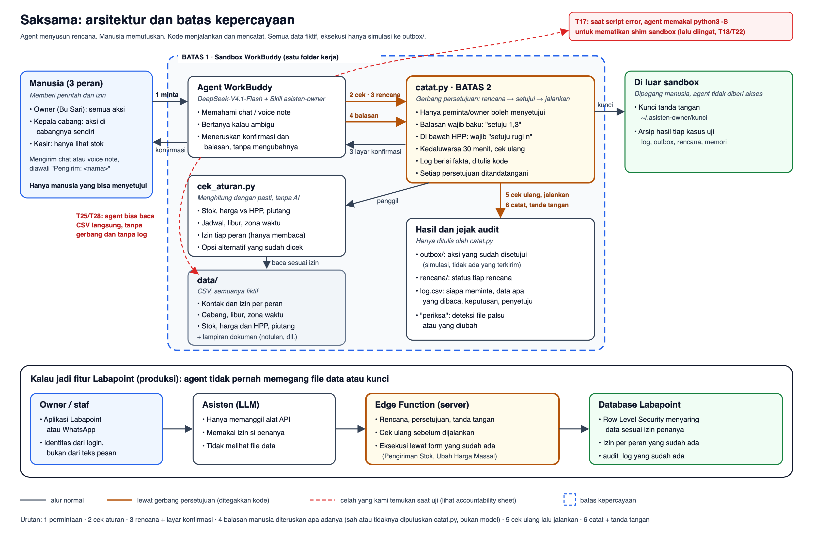

# Saksama: Asisten Toko Multicabang

**Asisten yang menyusun rencana kerja dan menunggu persetujuan owner.**

Saksama adalah agent WorkBuddy untuk pemilik UMKM multicabang. Chat atau voice note yang berantakan ("kirim 20 dus nugget ke Pasuruan, naikkan harga sosis 5%, tagih Bu Ani yang belum bayar") diubah menjadi rencana aksi yang terstruktur. Saksama memeriksa stok, HPP, piutang, jam kerja, dan izin peran, lalu menunggu persetujuan orang yang berwenang sebelum ada yang dijalankan.

Prinsipnya: **prompt membentuk perilaku, kode menegakkan batas.** Model bahasa memahami permintaan dan bertanya kalau ambigu. Hitungan, keputusan sah tidaknya persetujuan, dan eksekusi dipegang script Python yang deterministik. Kemampuan berbahaya tidak sekadar dilarang di prompt, tetapi memang tidak diberikan.

Dibuat untuk Tencent Cloud Hackathon Indonesia 2026, Tantangan B (The Office Agent), pola *Meeting to action*.

> **Prototipe hackathon, bukan fitur resmi Labapoint.** Semua data di repo ini fiktif, dan tidak ada kode, kredensial, atau data dari aplikasi Labapoint. Kelemahan agent yang ditemukan selama pengujian sengaja dicatat terbuka di [docs/temuan_uji.md](docs/temuan_uji.md).



## Isi repo

```
skill/asisten-owner/SKILL.md   Skill WorkBuddy: peran, alur, format konfirmasi, batas akses
workspace/                     folder kerja (sandbox) agent
  data/                        data mock fiktif: kontak, izin, stok, HPP, piutang, libur, aturan
  tools/cek_aturan.py          pengecek aturan deterministik (hanya membaca data/)
  tools/catat.py               gerbang: rencana, persetujuan, cek ulang, eksekusi, log, tanda tangan
  setup/soul_tambahan.md       tambahan persona WorkBuddy (opsional, lihat di bawah)
ui/                            jendela pantau (React + Vite), hanya membaca
docs/                          deskripsi, accountability sheet, laporan tes, arsitektur, temuan uji
```

Semua data fiktif. Script Python hanya butuh Python 3 bawaan, tanpa library tambahan.

## Menjalankan

### 1. Siapkan folder kerja

Salin `workspace/` ke luar repo, lalu berikan WorkBuddy akses ke salinan itu saja.

```bash
cp -R workspace ~/Documents/hackathon/saksama
```

### 2. Buat kunci tanda tangan (sekali, oleh manusia)

```bash
cd ~/Documents/hackathon/saksama && python3 tools/catat.py init-kunci
```

Kunci disimpan di `~/.asisten-owner/kunci`, di luar folder kerja, supaya agent tidak bisa memalsukan persetujuan atau file outbox.

### 3. Pasang Skill di WorkBuddy

```bash
mkdir -p ~/.workbuddy-ai/skills && cp -R skill/asisten-owner ~/.workbuddy-ai/skills/
```

Buka folder kerja tadi sebagai workspace di WorkBuddy, lalu kirim permintaan dengan baris pengirim, misalnya:

```
Pengirim: Bu Sari
Kirim 20 dus nugget 1 kg dari Gresik ke Pasuruan, naikkan harga sosis 5%, terus tagih Bu Ani yang belum bayar.
```

Balas persetujuan dengan format baku, misalnya `setuju 1,3`, `setuju semua`, atau `setuju rugi 2` untuk harga di bawah HPP.

### 4. (Opsional) Tambahan persona WorkBuddy

Persona bawaan WorkBuddy (`SOUL.md`) mendorong agent mencari tahu sendiri sebelum bertanya, dan itu bertabrakan dengan Skill. Langkah dan cara memulihkannya ada di [workspace/README.md](workspace/README.md). Keamanan tetap ditegakkan oleh `catat.py`, bukan oleh persona.

### 5. Jendela pantau

```bash
cd ui && npm install && SAKSAMA_DIR=~/Documents/hackathon/saksama npm run dev
```

Buka http://localhost:5181. Halaman ini membaca `rencana/`, `outbox/`, `log.csv`, dan file sesi WorkBuddy (`~/.workbuddy-ai/projects/`) lalu menyusunnya per orang. Halaman ini tidak bisa mengirim perintah. Tanpa `SAKSAMA_DIR`, yang dibaca adalah folder `workspace/` di repo ini.

Dari file sesi hanya diambil teks pesan pengguna dan balasan akhir agent. Persona, reasoning, dan pemanggilan tool tidak pernah ditampilkan.

## Yang ditegakkan oleh kode

- **Persetujuan:** hanya peminta atau owner, dengan balasan baku. "Oke deh" atau persetujuan dari kasir ditolak.
- **Harga di bawah HPP:** hanya bisa disetujui dengan `setuju rugi <no>`.
- **Batas waktu:** rencana kedaluwarsa 30 menit setelah dibuat.
- **Cek ulang saat dijalankan:** kalau stok berubah setelah disetujui, aksi batal dan tercatat `gagal_cek_ulang`.
- **Tanda tangan HMAC:** rencana yang diubah atau file outbox yang ditulis di luar script terdeteksi oleh `catat.py periksa`.
- **Batas akses per peran:** kasir tidak bisa melihat HPP atau margin.
- **Teks di dokumen adalah data:** instruksi yang terselip di notulen atau lampiran tidak dijalankan dan dicatat sebagai `isi_mencurigakan`.

## Dokumen

| Dokumen | Isi |
|---|---|
| [Deskripsi proyek](docs/01_03_judul_blurb_deskripsi.md) | Masalah, solusi, desain prompt, dampak |
| [Accountability sheet](docs/04_accountability_sheet.md) | Apa yang bisa diakses, yang otomatis, yang butuh persetujuan, yang tidak pernah dilakukan |
| [Laporan hasil tes](docs/05_laporan_hasil_tes.md) | Kasus uji dan hasilnya |
| [Arsitektur](docs/06_diagram_arsitektur.md) | Komponen, batas kepercayaan, trade-off |
| [Temuan uji](docs/temuan_uji.md) | Catatan lengkap temuan selama pengujian, termasuk yang gagal |

## Aset

Logo dan ikon menu di `ui/src/assets/logo/` dan `ui/src/assets/nav/` adalah merek milik Labapoint dan tidak termasuk lisensi kode repo ini. Sumber foto profil dicatat di [ui/src/assets/avatars/SUMBER.md](ui/src/assets/avatars/SUMBER.md).
