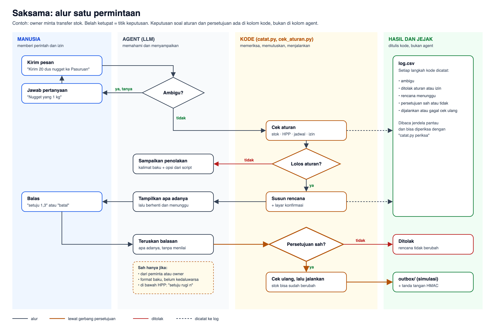

# Diagram Arsitektur: Saksama, Asisten Toko Multicabang

Dua gambar dengan tugas berbeda:

**1. Diagram arsitektur:** bagian apa saja, siapa memegang apa, dan di mana batas kepercayaannya.

**2. Alur satu permintaan:** apa yang terjadi langkah demi langkah. Setiap keputusan soal aturan dan persetujuan berada di kolom kode, bukan di kolom agent.

Sumber gambar: [06_diagram_arsitektur.svg](06_diagram_arsitektur.svg) dan [06b_flowchart_permintaan.svg](06b_flowchart_permintaan.svg) (bisa diedit); PNG beresolusi 2× untuk submit.

## Komponen

| Komponen | Peran | Siapa yang mengendalikan |
|---|---|---|
| Manusia (owner, kepala cabang, kasir) | Memberi permintaan dan **satu-satunya pemberi izin**, lewat WorkBuddy desktop atau Slack dari HP | Manusia |
| Agent WorkBuddy (LLM + persona + Skill) | Memahami bahasa, memecah permintaan, bertanya, menampilkan konfirmasi | Model, diarahkan persona platform (`SOUL.md`) dan Skill |
| `cek_aturan.py` | Hitungan pasti: stok, HPP, piutang, jadwal, izin peran | Kode deterministik, hanya membaca |
| `catat.py` | Gerbang: rencana, persetujuan, cek ulang, eksekusi, log, tanda tangan | Kode deterministik |
| `data/` | CSV fiktif + dataset panitia | Hanya dibaca |
| `outbox/`, `rencana/`, `log.csv` | Hasil simulasi dan jejak audit | Hanya ditulis `catat.py` |
| Kunci HMAC, arsip uji | Bukti keaslian dan arsip per kasus | Manusia, di luar sandbox |
| Jendela pantau (UI) | Menampilkan per orang: pesan, balasan agent dari sesi WorkBuddy, kartu gerbang, dan jejak audit | Hanya membaca; tidak bisa mengirim perintah |

## Batas kepercayaan

1. **Batas 1, sandbox WorkBuddy.** Agent hanya diberi satu folder kerja. Tidak ada akses ke kode Labapoint, kredensial, atau data tenant.
2. **Batas 2, gerbang persetujuan (`catat.py`).** Model tidak pernah memutuskan apakah sebuah balasan adalah persetujuan. Balasan diteruskan apa adanya, kode yang memutuskan sah atau tidak.
3. **Batas 3, di luar sandbox.** Kunci tanda tangan dan arsip uji dibuat dan disimpan manusia. Jendela pantau juga berjalan di sini dan hanya membaca: kemampuan mengirim perintah sengaja tidak diberikan, supaya tidak ada pintu masuk baru yang harus dijaga.

## Trade-off yang kami pilih (dan alasannya)

| Pilihan | Untung | Rugi | Bukti |
|---|---|---|---|
| Hitungan dan aturan di script, bukan di model | Angka pasti, sama setiap kali, bisa diuji tanpa kredit | Setiap aturan baru perlu ditulis sebagai kode | L02, L03, P01 |
| Persetujuan diputuskan kode, bukan model | "Oke deh", kasir yang menyetujui, dan diskon di bawah HPP tidak bisa lolos walau model tertipu | Owner harus memakai format balasan baku | L09, L11, L14, L03 |
| Kemampuan dicabut, bukan dilarang | Model tidak bisa mengisi kolom sumber atau menulis log "disetujui" karena opsinya tidak ada | Fleksibilitas berkurang | T13, T16 |
| Eksekusi hanya ke outbox (simulasi) | Aman untuk demo, tidak ada pesan atau stok sungguhan yang berubah | Belum terbukti di sistem nyata | Semua kasus |
| Log mencatat fakta, bukan tafsiran | Agent yang membaca log tidak bisa mengarang kejadian ("saya sudah bertanya") | Label keputusan lebih teknis | T33 |
| Opsi alternatif dihitung script | Kebutuhan model untuk "membantu" dipenuhi dengan opsi yang sudah dicek, bukan karangan | Script lebih panjang; opsi di luar script tetap mungkin muncul | T29, T35, T36, T37 |
| Stok simulasi dikurangi isi outbox | Transfer berikutnya tidak memakai stok yang sama dua kali | Bergantung pada outbox yang utuh | T31 |
| Isi mencurigakan dilaporkan sekali per berkas | Peringatan tetap berarti, log tidak ganda | Laporan ulang hanya bila berkas dipakai lagi | T41 |
| Data mentah tetap di folder kerja | Sederhana, cukup untuk lomba | **Agent bisa membaca CSV langsung dan melewati gerbang baca**, juga saat Skill aktif | T25, T28 |
| Persona platform ikut dirancang, bukan hanya Skill | Aturan Skill yang sebelumnya kalah oleh persona ("cari tahu sendiri") mulai dipatuhi: file data yang dibuka langsung turun dari 4 ke 0 di kasus jadwal | Bergantung pada pengaturan per pengguna WorkBuddy; satu run per sel, indikasi bukan statistik | T45, T46 |
| Jalur Slack lewat Local Assistant | Owner bisa memerintah dari HP | Permintaan **berulang** di sesi yang sama dijawab dari ingatan, tanpa script dan log | T47, T48 |
| Jendela pantau hanya membaca | Juri dan owner melihat semua kejadian, termasuk balasan tanpa gerbang (T48), tanpa menambah jalur perintah | Perintah tetap harus dikirim lewat WorkBuddy atau Slack | UI |
| Mengandalkan sandbox WorkBuddy | Tidak perlu infrastruktur tambahan | Agent bisa mematikan shim sandbox dengan `python3 -S` dan mengingat triknya | T17, T18, T22 |

## Yang berubah di produksi

Batas yang lemah di demo (T17, T25) ditutup dengan memindahkan data dan gerbang **keluar dari jangkauan agent**:

- Agent hanya memanggil API Labapoint dengan token si penanya; ia tidak pernah memegang file data atau kunci.
- Row Level Security dan izin peran yang sudah ada di Labapoint menyaring data di database.
- Rencana, persetujuan, tanda tangan, dan cek ulang ada di Edge Function (server).
- Eksekusi memakai form yang sudah ada (Pengiriman Stok, Ubah Harga Massal), dan tercatat di `audit_log` yang sudah ada.

Langkah antara yang bisa dicoba sebelum produksi: server MCP lokal yang memegang data dan gerbang di luar sandbox, sehingga agent di WorkBuddy hanya melihat daftar alat.
